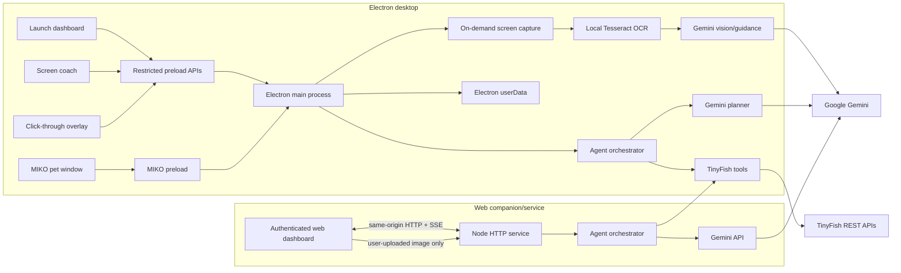

# MINDORA architecture

**Reviewed:** 2026-10-31. This describes the current source tree. Runtime claims and unverified areas are called out explicitly.

## Components

## Desktop runtime

`electron/main.ts` owns launch, coach, overlay, and MIKO BrowserWindows; screen/capture lifecycle; key storage; agent orchestration; and provider calls. All four windows set `contextIsolation`, `sandbox`, and `nodeIntegration: false`. Launch, coach, overlay, and pet windows are restricted to their bundled local page; popup windows are denied. `electron/preload.cjs` exposes app operations; `electron/pet/preload.cjs` exposes only pet controls and state events. Sensitive IPC handlers check the invoking window.

Screen guidance is user-triggered. The main process hides coach/overlay/MIKO before capture, resolves the current foreground window (when MINDORA owns focus it walks visible external windows in Windows Z order), selects the display containing that window, captures and crops that window, then restores MINDORA. OCR runs locally; the user-triggered window image, OCR text, active process/title, goal, and recent guidance turns are sent to Gemini. Only positively identified LibreOffice Calc enables its tested chart/formatting prompt and overlay. A task mentioning charts or files never selects an application mode. Other windows receive application-agnostic text guidance. MINDORA does not synthesize mouse or keyboard input; the user performs suggested actions and explicitly requests a fresh observation to verify.

Gemini coaching keys are stored under `<userData>/gemini_credential.enc` using Electron `safeStorage` when available; otherwise they are session-only. `GEMINI_MODEL` selects the model. The planner uses `GEMINI_API_KEY` from trusted process environment in Electron and the web service. No Gemini key is returned to renderer code.

MIKO uses its own transparent frameless window and narrow preload. Position, monitor ID, enabled/expanded state, and always-on-top preference are stored in `<userData>/miko-settings.json`; task/event state is runtime-only. It clamps to display work areas and falls back to the primary monitor if a saved display is unavailable. The app menu provides Quit even when MIKO remains visible after the main window closes.

## Agent and TinyFish

`server/agent/` implements plan validation, task state, dependencies, approvals, execution, retry boundaries, persistence, evidence, and events. Desktop task history is stored in `<userData>/agent-task-history.json`. Web history is stored in `MINDORA_WEB_DATA_DIR` or `.mindora-web/`. Desktop and web do not synchronize tasks or credentials; each process has separate history and providers.

TinyFish REST calls are typed and centralized in `server/integrations/tinyfish/client.ts`; credentials are read only in trusted main/server code. Search and Fetch use their service hosts; agent/research/profiles/monitors/wallet use the Agent API; Browser session support uses the Browser API. Provider operations are covered by mocked HTTP tests, not live credentials. See [TinyFish integration](TINYFISH_INTEGRATION.md) for operations and boundaries.

## Web service

`server/server.ts` serves compiled static assets and APIs. `MINDORA_WEB_ACCESS_TOKEN` gates private APIs; successful sign-in uses an in-memory 12-hour session registry and an HttpOnly, SameSite=Strict cookie (Secure when TLS is detected). The deployment uses one shared access token, not accounts or tenant isolation. SSE streams authenticated task updates. Gemini and TinyFish keys stay in the service environment. The web dashboard never uses Electron IPC and cannot capture the local display. Its screen guidance accepts user-uploaded screenshots.

Task/research history is file-backed in the configured web data directory. Active tasks, approvals, task events, sessions and SSE connections are process-local; there is no multi-instance coordination. Use one service instance and durable private storage for the current implementation.

## Build and packaging

- `npm run build`: TypeScript compile and static asset/fixture copies to `dist/`.
- `npm run build:installer`: build plus electron-builder Windows NSIS x64 installer in `release/`.
- `npm run build:web`: compile and copy web assets for Docker.
- Docker/Railway start `dist/server/server.js`; `PORT` defaults to 8080.
- The Electron Builder allowlist includes Electron output, shared code, agent and TinyFish modules; `.env`, tests, docs, fixtures and scripts are excluded from the packaged desktop app.

The app identity is `com.mindora.desktop`; userData is explicitly `<appData>/MINDORA`. Startup migrates missing compatible files from `<appData>/Unstuck` without removing the legacy directory or overwriting existing MINDORA files. Encrypted credential files are copied unchanged when safeStorage validation permits; see the migration map and release checklist for OS-profile verification.

## Known boundaries

- Foreground window identification and display selection support non-primary displays, but the Windows Z-order fallback and app identity are heuristic rather than a native foreground event hook.
- OCR grounds recognized text. It does not reliably identify non-text controls or spreadsheet cell ranges.
- Windows UI Automation tree inspection, local mouse/keyboard injection, native file APIs, autonomous local action execution, and an observe/plan/act/verify agent loop are not implemented. Desktop agent steps currently provide screenshot-grounded coaching and wait for user action; they are not a general-purpose computer-use driver.
- Browser automation is TinyFish goal-based execution, not a local low-level click driver. Security challenges must be handled by a person.
- Web auth is single-token and in-memory; task execution and event streams do not survive/reconcile process restarts.
- Live Gemini/TinyFish, installed-app lifecycle, code signing, upgrade behavior, and real credential migration require release-environment validation.
